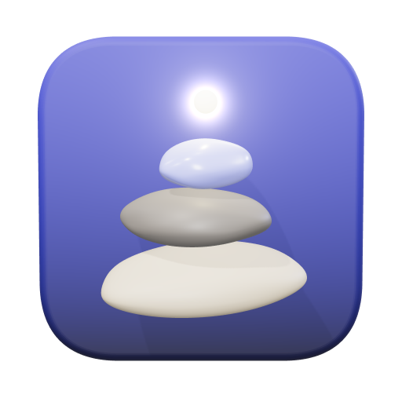

<p align="center"></p>

# Cairn

*Formerly REA (working name).* A cairn is a stack of stones that marks the way.

A local-first, privacy-first workspace for notes, documents, tasks, projects, databases, calendar and
personal knowledge, with optional AI. Everything runs on your machine; no account is required.

> This repository is separate from the `rea` reverse-engineering project (rea-agents), which was left untouched.

## Features at a glance

- **Block editor**: headings, lists, checklists, toggles, callouts, code with highlighting, tables, LaTeX math,
  Mermaid diagrams, images/video/audio/files, bookmarks, embedded pages, linked databases, table of contents.
  Slash commands, Markdown shortcuts, `[[wiki links]]` and `@mentions`, backlinks, find & replace, autosave, page history.
- **Databases**: 23 property types (relations, rollups, formulas…), table, board, list, gallery, calendar,
  timeline and chart views over the same records; nested filters, sorting, grouping, CSV/JSON import and export.
- **Tasks and projects**: subtasks, dependencies, recurrence, reminders, Eisenhower matrix, milestones, progress reports.
- **Calendar**: day/week/month/agenda, recurring events, drag to reschedule, ICS import and export.
- **Knowledge**: fuzzy full-text search (Ctrl+K), tags, related pages, interactive knowledge graph.
- **Cairn Intelligence (optional)**: Claude, OpenAI, Gemini, Ollama or any OpenAI-compatible local server.
  Workspace-aware chat with citations, writing tools with preview, tasks from notes. Cloud AI is off until you enable it.
- **Voice**: dictate into any page (Ctrl+Shift+M), record voice notes and meetings (optionally with computer audio on Windows), and get timestamped transcripts, summaries and action items. Speech is transcribed on your computer with Whisper; audio never leaves it.
- **Portability**: versioned full backups, Markdown/HTML/PDF/CSV/JSON export, Markdown/Obsidian/Notion import.

See [FEATURES.md](FEATURES.md) and the honest status matrix in [IMPLEMENTATION_STATUS.md](IMPLEMENTATION_STATUS.md).

## Requirements (Windows)

- Node.js 22 or later (tested with 26.13) and npm 11
- Git
- No Rust, Visual Studio or WebView2 is needed: the desktop app is Electron.

## Development

```powershell
npm install
npm run voice:setup    # once: downloads and verifies the local speech model (Whisper base, 73 MB) into public/voice/
npm run dev            # browser build at http://localhost:5183
npm test               # unit and integration tests
npm run typecheck
```

Run the desktop shell against the dev server:

```powershell
npm run build:electron
$env:REA_DEV_URL = "http://localhost:5183"; npx electron .
```

## Download

The latest Windows installer is on the [Releases page](https://github.com/tanyashsingh/notion_rea/releases/latest).

## Production build and Windows installer

```powershell
npm run build          # type check, web bundle (dist/), Electron bundle (dist-electron/)
npm run dist:win       # NSIS installer at release\Cairn Setup <version>.exe
```

The installer is per-user (no admin rights), lets you choose the folder, and is **unsigned**: Windows
SmartScreen will warn until a code-signing certificate is configured. Silent install: `"Cairn Setup <version>.exe" /S`.

## Where your data lives

| Build | Location |
|---|---|
| Desktop | `%APPDATA%\Cairn` (IndexedDB, settings, encrypted `secrets.json`). If a pre-rename `%APPDATA%\REA` folder exists and `Cairn` does not, the app keeps using `REA`. |
| Browser | The browser profile's IndexedDB for `localhost:5183` |

Uninstalling keeps your data. Delete `%APPDATA%\Cairn` to remove it. Use **Settings → Backup & restore** to
move a workspace between machines.

## Releasing

```powershell
npm version minor --no-git-tag-version   # bump package.json, then update CHANGELOG.md
npm run check:all
npm run dist:win
git tag -a vX.Y.Z -m "Cairn X.Y.Z"; git push --follow-tags
& "C:\Program Files\GitHub CLI\gh.exe" release create vX.Y.Z "release\Cairn Setup X.Y.Z.exe" --notes-file notes.md
```

## Updating

Install a newer `Cairn Setup x.y.z.exe` over the existing one; data is preserved and the database migrates on
first launch. Automatic updates are not configured.

## Environment variables

None are required. See [.env.example](.env.example). AI keys are entered in **Settings → AI providers**
and stored with Windows DPAPI, never in files in this repository.

## Security notes

Sandboxed renderer with context isolation, strict Content Security Policy, IPC sender verification,
sanitised rich text and AI output, link protocol allow-list, blocked executable attachments, CSV
formula-injection guard, and an `eval`-free formula engine. No telemetry. Cairn does **not** encrypt data at
rest beyond your Windows account protection and offers no end-to-end encryption.

## Documentation

[ARCHITECTURE.md](ARCHITECTURE.md) · [DATABASE_SCHEMA.md](DATABASE_SCHEMA.md) · [TESTING.md](TESTING.md) ·
[PROJECT_PLAN.md](PROJECT_PLAN.md) · [CHANGELOG.md](CHANGELOG.md) · [CLAUDE.md](CLAUDE.md)

## Brand

The logo is a real 3D render: `brand/logo-scene.ts` (three.js) is rendered in headless Chrome by
`node scripts/render-logo.mjs`, which writes `brand/cairn-logo-{1024,512}.png`, `build/icon.png`, `public/favicon.png`
and `src/assets/cairn-mark*.png`. Re-run it after editing the scene.

## Extending Cairn

- New block: add a TipTap node in `src/editor/extensions.ts` (plus a node view in `nodeViews.tsx`), register
  it in `src/editor/schema.ts`, add a slash item in `slashItems.ts`, and handle it in `docToMarkdown`.
- New property type: extend `PropertyType` in `src/data/types.ts`, then `cellValue`/`displayValue` in
  `src/lib/dbquery.ts` and the editor in `src/views/database/cells.tsx`.
- New AI provider: add a branch to `streamChat`/`embed`/`listModels` in `src/ai/providers.ts` and defaults in `store/settings.ts`.
- Schema change: follow the migration rules in DATABASE_SCHEMA.md.
